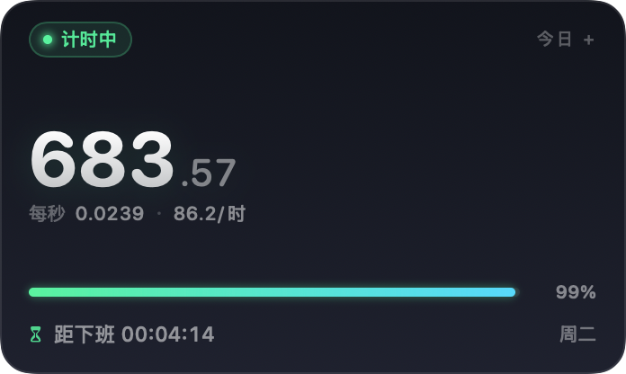
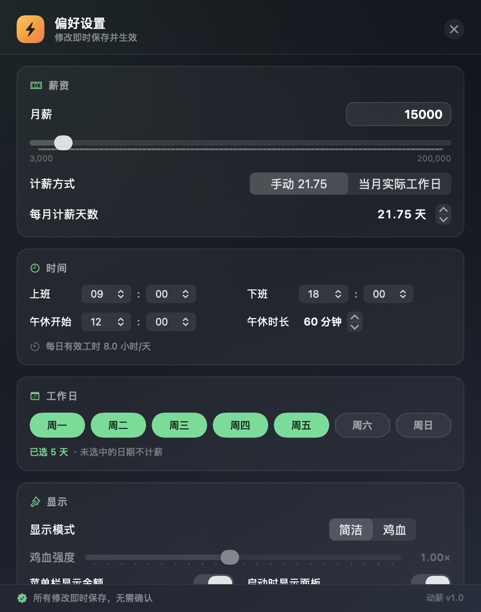
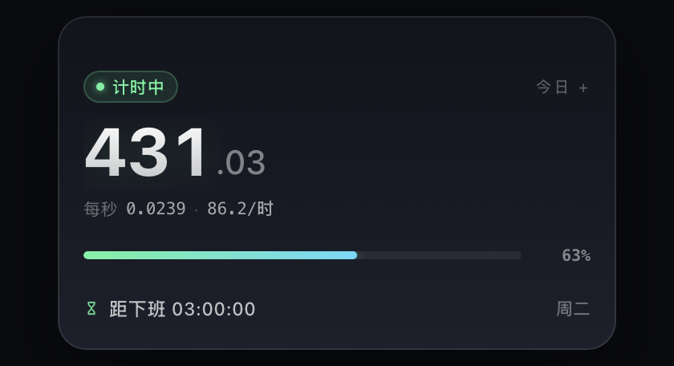

# 动薪 · DongXin

> 让薪动起来。English: **DongXin** (Salary in Motion).

> 把「今天正在赚到的钱」放在桌面角落，每一秒都在涨。
> macOS 原生 / 菜单栏常驻 / 纯本地 / 无账号 / 无网络请求。

---

## 三个版本

| 平台 | 形态 | 说明 |
|---|---|---|
| **macOS** | 原生 SwiftUI 菜单栏 App（2.2 MB） | 仓库主版本，`./build.sh` 构建 |
| **Windows** | Electron 桌面浮窗（置顶/无边框/托盘） | `desktop/`，安装包由 GitHub Actions 在 `windows-latest` 构建，见 [Actions](https://github.com/dmy-wang/dongxin/actions/workflows/windows.yml) 产物 `DongXin-Windows` |
| **Web** | 单页应用，浏览器直接打开 | `web/index.html`，也部署在 GitHub Pages |

## 两种模式

| | 简洁模式 | 鸡血模式 |
|---|---|---|
| 画面 | 深色玻璃 + 大号等宽数字，安静 | 金币粒子、里程碑横幅、连击数、励志语、发光进度条 |
| 适合 | 不想被打扰，只想余光扫一眼 | 需要即时正反馈，把「上班」变成「打怪升级」 |
| 动效 | 数字轻微过渡 | 每跨 1 元脉冲、每 ¥10 爆一次横幅、粒子随强度缩放 |

## 功能

- **实时入账**：按秒计算今日已赚，精确到分；菜单栏常驻显示金额（可关）。
- **下班倒计时**：剩余工作时长 + 今日进度条；剩余 <1 小时变红脉冲。
- **状态感知**：未上班 / 工作中 / 午休 / 已下班 / 休息日，各自有对应文案与动效。
- **计薪规则**：月薪 ÷ 每月计薪天数（21.75 或当月实际工作日）÷ 每日有效工时；自动扣除午休。
- **工作日**：周一~周日任意勾选；非工作日自动归零并显示「明天几点继续」。
- **悬浮小窗**：无边框、置顶、可拖拽、记住位置、可跨桌面/全屏显示。
- **开机自启**：设置里一键写入 LaunchAgent。
- **纯本地**：配置存 UserDefaults，不联网、不上传、不登录。
- **隐私友好**：默认不显示货币符号（纯数字），可选「圆点前缀 ·」或「货币符号」；适合工位/咖啡馆投屏等公开场合。

## 安装

1. 把 `动薪.app` 拖进 `/Applications`；
2. 首次打开：**右键 → 打开**（未做 Apple 公证，系统会提示一次）；
3. 若提示「已损坏」，在终端执行一次：
   ```bash
   xattr -dr com.apple.quarantine /Applications/动薪.app
   ```
4. 打开后：菜单栏出现今日金额，桌面右上角出现浮窗。

## 截图

| 简洁模式 | 鸡血模式 |
|---|---|
|  |  |

设置页：

Windows / Web 版：

| 简洁 | 鸡血 |
|---|---|
|  |  |

## 使用

| 操作 | 效果 |
|---|---|
| 左键点菜单栏金额 | 显示/隐藏浮窗 |
| 右键点菜单栏金额 | 菜单：模式切换、设置、重置今日、开机自启、退出 |
| 拖拽浮窗 | 移动位置（自动记住） |
| 鼠标悬停浮窗 | 右上角出现 切换模式 / 设置 / 隐藏 按钮 |
| ⌘, | 打开设置（菜单在菜单栏右键里） |

## 隐私说明

默认 `数字前缀 = 纯数字`：界面上显示的是 `643.61`，没有 `¥`、`元`、`工资` 等字眼；
需要的话可在设置 → 隐私里切换为 `·643.61`（圆点前缀）或 `¥643.61`（货币符号）。

## 计算规则

```
每秒收入 = 月薪 ÷ 每月计薪天数 ÷ 每日有效秒数
每日有效秒数 = (下班时间 − 上班时间) − 午休时长
今日已赚 = 每秒收入 × 今天已工作的有效秒数（自动跳过午休）
```

默认：月薪 15000、21.75 天、9:00–18:00、午休 12:00–13:00 →
`15000 ÷ 21.75 ÷ 28800 ≈ 0.0240 元/秒 ≈ 86.2 元/时`。

## Windows / Web 构建

```bash
# Windows 安装包（在 Windows 上执行，或交给 CI）
cd desktop
npm install
npm run dist:win      # 输出 desktop/release/DongXin Setup *.exe + portable

# 本地起 Electron 调试
npm start

# 纯网页版：直接双击 web/index.html（无需构建）
```

Windows 版特性与 macOS 一致：无边框置顶浮窗、托盘图标与菜单、简洁/鸡血双模式、隐私前缀、本地存储配置。
CI 会在每次推送 `web/` 或 `desktop/` 时自动构建，产物在 Actions 页面可下载。

开发期截图（macOS 本地，用 DSH 自带 Electron）：

```bash
E="$HOME/.dsh/electron/Electron.app/Contents/MacOS/Electron"
env -u ELECTRON_RUN_AS_NODE SHOT_OUT=/tmp/shot.png SHOT_QUERY="mode=hype&salary=15000&now=15:00" \
  SHOT_W=520 SHOT_H=380 "$E" --no-sandbox tools/shotter
```

## 从源码构建

```bash
cd work/app
./build.sh
open build/动薪.app
```

本机 `swiftc` 的 driver 在受限环境下会 `SIGTRAP`，因此构建脚本直接用
`swift-frontend` 逐文件编译、再用 `clang` 链接，最后 `codesign -s -` 自签名。
不依赖 Xcode 工程、不依赖第三方库。

引擎自测：

```bash
./build/动薪.app/Contents/MacOS/SalaryPulse --selftest
# SELFTEST ok=21 fail=0
```

## 源码结构

```
Sources/
├── main.swift       NSApplication / 菜单栏 / 浮窗 / 右键菜单
├── Models.swift     SalaryConfig / SalarySnapshot / SalaryEngine（纯逻辑）
├── AppModel.swift   ObservableObject、持久化、开机自启
├── Style.swift      主题色、渐变、共用组件
├── SimpleView.swift 简洁模式
├── HypeView.swift   鸡血模式
├── Effects.swift    粒子 / 里程碑横幅 / 连击
├── SettingsView.swift 设置窗口
└── SelfTest.swift   引擎自测
```

## 设置项

| 分组 | 项目 |
|---|---|
| 薪资 | 月薪、计薪方式（手动 21.75 / 当月实际工作日）、每月计薪天数 |
| 时间 | 上班/下班时间、午休开始、午休时长、每日有效工时（自动换算） |
| 工作日 | 周一~周日任意勾选，未选中不计薪 |
| 显示 | 简洁/鸡血模式、鸡血强度（0.5–1.6）、菜单栏显示金额、启动显示面板、励志语、音效 |
| 隐私 | 数字前缀（纯数字 / 圆点 · / 货币符号）、货币符号自定义 |
| 预览 | 每秒、每小时、每日、每月 + 状态 + 倒计时 + 今日进度 |
| 操作 | 重置今日进度、恢复默认、开机自启、关闭 |

## 已知限制

- 未做 Apple Developer 签名与公证：首次打开需右键→打开，或手动去隔离属性。
- 仅支持 macOS 14+（用到了 `contentTransition(.numericText())`、`TimelineView` 等）。
- 无多语言（仅中文）。
- 计薪模型为「按工作日均匀折算」，不含个税、社保、加班费、年终奖。
